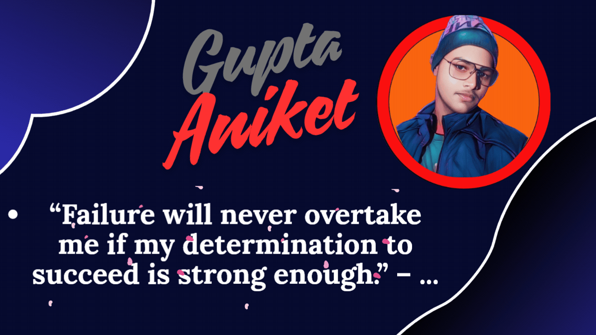

  

<h1 align="center">Hi there, I'm Aniket Gupta 👋</h1>
<h3 align="center">Data Analyst & Data Scientist · Web Developer · Turning data into stories</h3>

  
  
  
  
  

---

## 💫 About Me

- 📊 I turn raw data into insights with **Python, SQL, and Machine Learning**
- 📈 I build dashboards and data stories with **Power BI, Tableau, and Excel**
- 🌐 I build web apps with **Streamlit, JavaScript, React, Node.js, and Firebase**
- 🤖 Currently exploring how **AI, Data Science, and web tech** can solve real-world problems
- 📍 Based in **Maharashtra, India** · open to Data Analyst / Data Science opportunities
- ⚡ Fun fact: I believe data isn't just numbers. It's a story waiting to be told!

---

## 🚀 Featured Projects

| Project | Description | Tech |
| --- | --- | --- |
| 🎥 [YouTube-InsightX](https://github.com/Aniketgupta149/YouTube-InsightX) | Analyze any YouTube channel: growth, engagement, top videos, and CSV/Excel export | Python · Streamlit · Plotly · YouTube API |
| 🌦️ [Meteorology-Analytics-Pro](https://github.com/Aniketgupta149/Meteorology-Analytics-Pro) | Weather analytics platform with air-quality analysis, alerts, and multi-city comparison | Python · Streamlit · Plotly · SciPy |
| ⛅ [weather-Dashboard](https://github.com/Aniketgupta149/weather-Dashboard) · [Live](https://weather-dashboard149.streamlit.app/) | Real-time weather dashboard with 5-day forecast and analytics charts | Python · Streamlit · Seaborn |
| 🎧 [Spotify-Analysis-Dashboard](https://github.com/Aniketgupta149/Spotify-Analysis-Dashboard) | Churn analysis of 8,000 users: who churns, why, and how engagement drives retention | Tableau · Figma |
| 📊 [Boat-powerbi-dashboard](https://github.com/Aniketgupta149/Boat-powerbi-dashboard) | Sales, customer, and financial dashboard for boAt with KPIs and geo maps | Power BI · DAX · Figma |
| 👟 [Nike_Sales_Dashboard](https://github.com/Aniketgupta149/Nike_Sales-_Dashboard) | Interactive Excel dashboard of Nike sales by region, product, and time | Excel |
| 🏥 [Hospital-management-system](https://github.com/Aniketgupta149/Hospital-management-system) | Relational database for patients, doctors, appointments, and billing | MySQL |
| 🔍 [GitHub-Profile-Finder](https://github.com/Aniketgupta149/GitHub-Profile-Finder) · [Live](https://aniketgupta149.github.io/GitHub-Profile-Finder/) | Search any GitHub user and browse their profile and top repos | HTML · CSS · JavaScript |
| 🗜️ [smart-file-compressor-decompressor](https://github.com/Aniketgupta149/smart-file-compressor-decompressor) | Client-side text file compression using Huffman encoding | HTML · CSS · JavaScript |

📚 **Learning in public:** [Mathematics & Statistics for Data Analysis](https://github.com/Aniketgupta149/Mathematics-and-Statistics)
🎓 **Certifications:** [IBM](https://github.com/Aniketgupta149/IBM_Certifications) · [Data Science & Analytics](https://github.com/Aniketgupta149/My-Certificates-of-Data-Science-Analytics)

---

## 💻 Tech Stack

**Languages**
 

**Data Science & Machine Learning**
 

**Visualization & BI**
 

**Web, Cloud & Databases**
 

**Tools & Design**
 

---

## 📊 GitHub Stats

  
  

  

### ✍️ Random Dev Quote

  

---

  
    
  

