<!-- Animated header -->


<p align="center">
  <a href="https://aniket-portfolio149.web.app/">
    
  </a>
</p>

<p align="center">
  
  
  
</p>

<p align="center">
  <a href="https://aniket-portfolio149.web.app/"></a>
  <a href="https://www.linkedin.com/in/aniket-gupta-b44611261"></a>
  <a href="mailto:ag1499459@gmail.com"></a>
  <a href="https://instagram.com/itz__aniket1499"></a>
</p>

---

##  About Me

<table>
<tr>
<td width="58%" valign="middle">

I'm **Aniket**, a **Data Analyst & Data Scientist** from Maharashtra, India 🇮🇳, with a **B.Sc. in Computer Science** from Mumbai University (CGPA 8.25).

I turn messy data into **clear business decisions**. My work ranges from **Power BI and Tableau dashboards** to **Python analytics apps** that pull live data from the YouTube and OpenWeatherMap APIs. In my Spotify churn study of 8,000 users, I found a **25.9% churn rate** and showed that **engagement is the strongest predictor of retention**.

Before data, I was a **web development intern and then a junior teacher**, so I can build the tool *and* explain the insight to people who aren't technical.

</td>
<td width="42%" align="center">
  
</td>
</tr>
</table>

<p align="center">
  
</p>

###  What I Bring to Your Team

| Strength | How I apply it |
| --- | --- |
| 🔎 **Business-first thinking** | Start from the question (churn, sales drivers, KPIs), then find the data that answers it |
| 🧹 **Clean, reliable data** | Data cleaning and modelling with Excel, SQL (joins, aggregations) and Pandas |
| 📊 **Dashboards people use** | Power BI (DAX), Tableau, Excel and Streamlit. Six built, one deployed live |
| 🐍 **Working analytics apps** | Python apps on live APIs (YouTube Data API, OpenWeatherMap) with Plotly charts and data export |
| 🎤 **Clear communication** | Taught web development to students, so presenting insights to stakeholders comes naturally |
| 🎨 **Design sense** | Figma-designed dashboard layouts that are clean and presentation-ready |

```python
class AniketGupta:
    def __init__(self):
        self.role       = "Data Analyst | Data Scientist | Web Developer"
        self.location   = "Maharashtra, India 🇮🇳"
        self.education  = "B.Sc. Computer Science, Mumbai University (CGPA 8.25)"
        self.experience = ["Web Development Intern", "Junior Web Development Teacher"]
        self.stack      = {
            "analysis": ["Python", "SQL", "Pandas", "NumPy", "Excel"],
            "bi":       ["Power BI", "Tableau", "Streamlit", "Plotly"],
            "ml_ai":    ["scikit-learn", "TensorFlow", "Prompt Engineering", "crewAI"],
            "web":      ["JavaScript", "React", "Node.js", "Firebase"],
        }
        self.languages  = ["English", "Hindi", "Marathi"]
        self.learning   = ["Statistics", "Machine Learning"]
        self.motto      = "Data is a story waiting to be told."

    def workflow(self):
        return "Question ➜ Collect ➜ Clean ➜ Analyze ➜ Visualize ➜ Decide 💡"
```

- 🌱 **Currently learning:** Statistics & Machine Learning. Follow along in [Mathematics & Statistics](https://github.com/Aniketgupta149/Mathematics-and-Statistics)
- 🎯 **Looking for:** Data Analyst / BI Analyst roles and collaborations
- 📫 **Reach me:** [ag1499459@gmail.com](mailto:ag1499459@gmail.com) · [LinkedIn](https://www.linkedin.com/in/aniket-gupta-b44611261)

---

##  My Journey

<p align="center">
  
</p>

---

## 🛠️ Analytics Toolkit

<p align="center">
  
</p>

<p align="center">
  
  
  
  
  
  
  
  
  
  
  
  
</p>

---

##  Featured Data Projects

<table>
<tr>
<td width="50%" valign="top">

### 🎧 [Spotify Churn Analysis](https://github.com/Aniketgupta149/Spotify-Analysis-Dashboard)
**Tableau · Figma**
Analyzed 8,000 users: **25.9% churn**. Found engagement is the strongest predictor of retention.

</td>
<td width="50%" valign="top">

### 📊 [boAt Sales Dashboard](https://github.com/Aniketgupta149/Boat-powerbi-dashboard)
**Power BI · DAX**
Sales, customer and financial KPIs with channel analysis and geo maps across India.

</td>
</tr>
<tr>
<td valign="top">

### 🎥 [YouTube InsightX](https://github.com/Aniketgupta149/YouTube-InsightX)
**Python · Streamlit · Plotly**
Channel analytics: growth trends, engagement rates, top videos and data export.

</td>
<td valign="top">

### 🌦️ [Meteorology Analytics Pro](https://github.com/Aniketgupta149/Meteorology-Analytics-Pro)
**Python · Plotly · SciPy**
Weather & air-quality analytics with correlations, alerts and multi-city comparison.

</td>
</tr>
<tr>
<td valign="top">

### 👟 [Nike Sales Dashboard](https://github.com/Aniketgupta149/Nike_Sales-_Dashboard)
**Excel · Pivot Tables**
Cleaned raw sales data and built an interactive dashboard by region, product and time.

</td>
<td valign="top">

### 🏥 [Hospital Management DB](https://github.com/Aniketgupta149/Hospital-management-system)
**MySQL**
Relational schema for patients, doctors, appointments and billing with analytical queries.

</td>
</tr>
</table>

<p align="center">
  <a href="https://weather-dashboard149.streamlit.app/"></a>
  <a href="https://aniketgupta149.github.io/GitHub-Profile-Finder/"></a>
</p>

---

##  Achievements & Certifications

- 🥇 **Winner**, Nav-Parivartan National-Level Poster Presentation
- 🔬 **Finalist**, Aavishkar Research Project (Wave & Tidal Power Generation)
- 🏅 **School Topper in Computer Science** and Science Exhibition Winner

<p align="center">
  
  
  
  
  
  
</p>

| 📚 Learning in public | 🏅 Certificate repos |
| --- | --- |
| [Mathematics & Statistics for Data Analysis](https://github.com/Aniketgupta149/Mathematics-and-Statistics) | [IBM: Python, Data Analysis, Machine Learning](https://github.com/Aniketgupta149/IBM_Certifications) |
| [30 Days of Excel Data Analysis](https://github.com/Aniketgupta149/30-Days-Of-Excel-Data-Analysis) | [NSDC + SQL, Power BI, Tableau, Excel](https://github.com/Aniketgupta149/My-Certificates-of-Data-Science-Analytics) |

---

## 📈 GitHub Analytics

<p align="center">
  
  
</p>
<p align="center">
  
</p>
<p align="center">
  
</p>

<!-- Snake animation, generated daily by .github/workflows/snake.yml -->
<p align="center">
  <picture>
    <source media="(prefers-color-scheme: dark)" srcset="https://raw.githubusercontent.com/Aniketgupta149/Aniketgupta149/output/github-snake-dark.svg" />
    
  </picture>
</p>

---

<p align="center">
  
</p>

<p align="center">
  <a href="https://buymeacoffee.com/Aniket149"></a>
</p>


